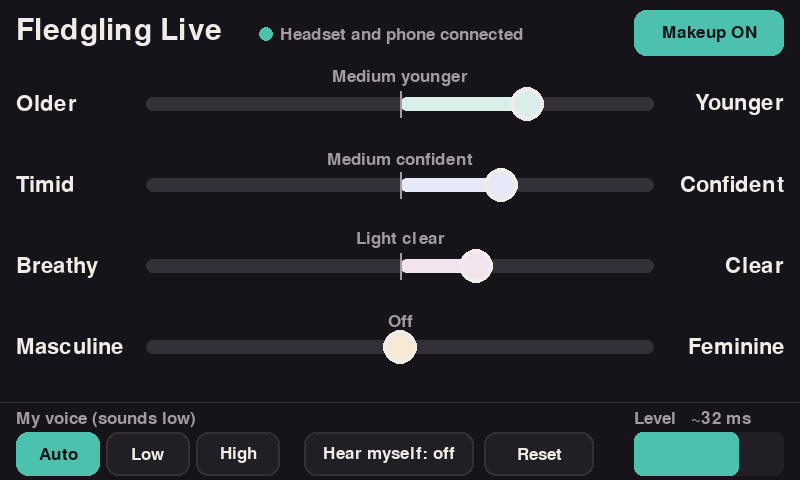

# Fledgling Live: the voice box

A small box that sits between your headset and your phone or computer and gives your voice
live "voice makeup" on calls: Younger, Confident, Clear and Masculine/Feminine, the same four
sliders as the Fledgling app.



```
 USB headset ──► [ Raspberry Pi 4B + 5" touch screen ] ──USB-C──► phone / computer
  (mic + ears)     voice makeup, ~21 ms                 seen as a USB sound card
                                                        called "Fledgling Live Voice"
```

The phone or computer sees an ordinary USB sound card, so every app works with it: Zoom, Teams,
Meet, WhatsApp and normal phone calls. Call audio comes back through the box to your headset.
"Hear myself" mixes your made-up voice into your ears so you can hear what others hear.

## Why a box, and not just the phone

| Route | Live voice into a call? | Notes |
|---|---|---|
| Phone app (web or native) | **No** | Neither iOS nor Android lets one app act as the microphone for another app (Android only with root). A phone app can do a live "listen to yourself" preview with headphones, but it can't send the result into Zoom or a phone call. |
| Computer + virtual audio cable | Yes | BlackHole (Mac) or VB-Cable (Windows) plus a live page. Software only, but computers only, and a fiddly setup for non-technical users. |
| **This box** | **Yes, phone and computer** | It is a USB sound card, so no app or setting is needed beyond picking it as the mic. |

The effect core (`dsp/fx.c`) is plain C with no dependencies, so it can also be compiled to
WebAssembly later for a live mode in the app (preview on phones, calls on computers).

## Parts (prototype, all off the shelf)

| Part | Approx. price | Notes |
|---|---|---|
| Raspberry Pi 4 Model B, 2 GB | $45 | 1 GB is enough; 2 GB is easier to find. |
| microSD card, 16–32 GB | $8 | Raspberry Pi OS Lite (64-bit). |
| 5-inch touch screen | $35–45 | Official Raspberry Pi Touch Display 2 (5", DSI ribbon) or any 800×480 HDMI touch screen. Use it in landscape. |
| **USB-C power + data splitter** for Pi 4 | $10–20 | Important, see Power below. Search "Raspberry Pi 4 USB-C power data splitter" or "OTG power splitter". |
| 5 V 3 A USB-C power supply, or a USB-C power bank | $8–25 | Powers the box through the splitter. |
| USB headset | (yours) | Any plain USB headset (class-compliant). Plug into a USB-A port. |
| Cable to the phone/computer | $5–10 | USB-C to USB-C. Older iPhones: Apple Lightning to USB 3 Camera Adapter. |
| Stretch: USB 3.5 mm headset adapter | $8 | A small "USB sound card" with a 4-pole TRRS jack lets you use an ordinary wired headset. The engine picks up any USB audio device on its own, so this needs no code changes. |

### Power (read this)

On the Pi 4 the USB-C port is the only port that can act as a USB device, **and** it is the
power input. A phone can't power a Pi 4 plus a screen. The splitter fixes this: the Pi takes
power from your supply and only the data lines go to the phone. Don't power the Pi from the
GPIO pins while the USB-C port is connected to a phone or computer without a splitter that
cuts the phone's 5 V line, or the two supplies will fight.

The gadget tells the phone it is self-powered and draws no power, so iPhones accept it.

## Setup

1. Flash **Raspberry Pi OS Lite (64-bit)** with Raspberry Pi Imager. In its settings, turn on
   SSH and set up Wi-Fi so you can log in from a computer.
2. Log in (`ssh pi@<name>.local`) and run:
   ```sh
   sudo apt install -y git
   git clone https://github.com/cybtinker/robin
   cd robin/box
   sudo sh setup/install.sh
   sudo poweroff
   ```
3. Wire it: headset into a USB-A port, splitter into the Pi's USB-C port, power into the
   splitter's power side, and the splitter's data side to your phone or computer.
4. Power on. The screen shows the sliders. On the phone or computer, pick
   **Fledgling Live Voice** as the microphone and speaker (most phones switch to it on their own).

Test with a computer first: it is the easiest to check. On a Mac, open System Settings → Sound
and look for "Fledgling Live Voice" under Input and Output; on Windows, Sound settings.

### Useful commands

```sh
journalctl -u fledgling-box -f                     # engine log
echo stat | nc -u -w1 127.0.0.1 9555               # live status: pitch, levels, xruns, latency
echo "looks 80 50 30 0" | nc -u -w1 127.0.0.1 9555 # set Younger Confident Clear Gender (-100..100)
echo "bypass 1" | nc -u -w1 127.0.0.1 9555         # makeup off (same delay, no click)
arecord -l; aplay -l                               # list sound cards
```

Engine options (edit `/etc/systemd/system/fledgling-box.service`):
`--mic DEV --ear DEV` (default: first USB headset found), `--host DEV` (default: the gadget),
`--period 128` (frames per block; 64 is lower delay, more CPU wake-ups), `--latency 21`
(effect delay in ms; 14 is fine for higher voices), `-v` (log device settings).

## How the effect works

The app's WORLD vocoder needs the whole recording, so the box uses a lighter, streaming method
(`dsp/fx.c`), PSOLA, which suits a single voice:

| Slider | What the box changes |
|---|---|
| Older ↔ Younger | pitch (up to +1.5 st for low voices, +2.5 st for higher voices), voice size (formants, up to +5 % / +6 %), steadiness, clarity, a little brightness |
| Timid ↔ Confident | steadiness (less tremor and jitter), clarity, presence (2–5 kHz), levelling compressor; timid is softer and quieter |
| Breathy ↔ Clear | clear: blends each pitch period with the two before it, which averages away breath noise; breathy: adds soft noise that follows your voice |
| Masculine ↔ Feminine | pitch (up to ±7.5 st) and voice size together; it is a moderate shift, not a full gender change |

The slider-to-setting mapping is a port of the app's `base()` in `app.js`, including the gentler
shifts for higher (female) voices. "My voice" Auto picks low or high from your average pitch.

### Delay budget (48 kHz)

| Stage | Delay |
|---|---|
| Effect (two pitch periods of a low voice) | 21 ms |
| Mic block in + output buffer (128-frame blocks) | ~11 ms |
| USB transfer | ~1–2 ms |
| **Box total (estimate)** | **~33 ms** (~27 ms with `--period 64`) |

The phone or meeting app adds its own buffering on top, as it does with any USB headset. These
are estimates; measure on the Pi with `echo stat | nc -u -w1 127.0.0.1 9555`.

CPU: 2–4 % of one laptop core in the offline test; expect roughly 10–15 % of one Pi 4 core.

### Test without the hardware

```sh
make
./wavfx in.wav out.wav --age 50 --conf 40 --tone 30 --gender 0   # same settings as the sliders
./wavfx in.wav out.wav --pitch 3 --formant 8 --wobble -60 --clarity 4   # direct settings
```

## Smaller box later

- **Pi Zero 2 W**: tiny and cheap, but it has one USB data port. In use as the phone's sound
  card it can't also host a USB headset, so it needs an I2S audio board with a 3.5 mm jack
  (wired headset only). Its CPU should manage the effect, but this needs measuring.
- **Radxa Zero 3W**: same size, with a USB-C device port and a separate USB host port, so it
  keeps the USB headset and has more headroom. The software here is plain Linux (ALSA +
  configfs gadget) and should port with small changes to the setup script.

## Files

| Path | What |
|---|---|
| `dsp/fx.c`, `dsp/fx.h` | Streaming effect, portable C, no dependencies |
| `engine/fledgling-box.c` | ALSA audio engine: headset ⇄ effect ⇄ USB gadget, drift correction, UDP control |
| `ui/box_ui.py` | Touch-screen sliders (pygame, no desktop needed) |
| `setup/usb-gadget.sh` | Makes the USB-C port a USB sound card (UAC2) |
| `setup/install.sh` | One-time install: packages, build, boot config, services |
| `tools/wavfx.c` | Offline test: run the live effect on a WAV file |

WORLD is not used here; nothing in the box needs a GPL or LGPL library.
