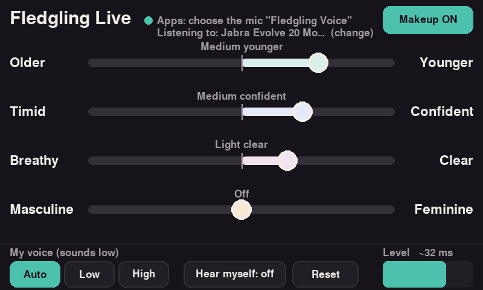

# Fledgling Live on a Pi 400: calls and YouTube

The Pi 400 is the whole computer here. Fledgling Live adds a microphone called
**Fledgling Voice** that carries your made-up voice, and any app on the Pi can use it:
Zoom, Teams and Meet in Chromium, OBS for YouTube videos and live streams, Audacity for voice-overs.

About 20 minutes. You need:

- The Pi 400 with **Raspberry Pi OS with desktop, Bookworm or newer** (64-bit recommended; 32-bit
  works too). Check in a Terminal: `grep PRETTY /etc/os-release` should say bookworm or trixie.
  Older versions (Bullseye) use PulseAudio and are not supported.
- A screen on the micro-HDMI port.
- A mic. The Pi 400 has no headphone or mic jack, so use one of these:
  - a **USB headset** (best: clean sound and no echo), or a USB-to-3.5 mm adapter for a wired headset;
  - a **Bluetooth headset** (works, but Bluetooth mics sound thinner, like a phone call);
  - a **webcam's mic** (fine for recording; in calls use headphones, or others hear an echo).
- Optional: a USB webcam.

If your SD card came from Fledgling, the app is already installed: skip to step 2.

## 1. Install (one command)

Open a Terminal (menu → Accessories → Terminal) and paste:

```sh
git clone https://github.com/cybtinker/robin && cd robin && git checkout claude/project-thread-imz1ou && sh box/desktop/install.sh
```

It asks for your password, builds the app (a minute or two on a Pi 400) and installs it.
To update later: `cd robin && git pull && sh box/desktop/install.sh`.

## 2. Open it



Plug in the headset, then open **menu → Sound & Video → Fledgling Live**. At the top it says
*Apps: choose the mic "Fledgling Voice"* and, under that, *Listening to:* with your mic's name.

- It picks a USB headset first, then a Bluetooth headset, then a webcam mic. Plug in a headset
  later and it switches on its own.
- To use a different mic, click the *Listening to* line. Each click moves to the next mic, and it
  remembers your choice.
- *Plug in a headset or mic* means it found no mic. With Bluetooth, the headset must be in
  "headset" mode (click the speaker icon on the taskbar and pick the headset's mic as input once).

Click **Hear myself** and talk: you hear what others will hear (with a small delay that only you
hear). Move the sliders while you talk. **Makeup ON / OFF** compares with your own voice.

**Keep the window open while you use it.** Closing it turns the makeup off and removes the
"Fledgling Voice" mic, and apps then go back to your plain mic.

## 3. Calls: Zoom, Teams, Meet

Zoom and Teams have no apps for the Pi, so use them in Chromium. They work the same in the browser.

1. While Fledgling Live is open, "Fledgling Voice" is the Pi's default mic, so sites normally pick it
   by themselves. To be sure for every site: open `chrome://settings/content/microphone` in
   Chromium and choose **Fledgling Voice**.
2. Try a test call:
   - Zoom: https://zoom.us/test → *Join from your browser*
   - Teams: https://teams.live.com → *Meet now* (or your work's Teams at https://teams.microsoft.com)
   - Google Meet: https://meet.google.com → *New meeting*
3. Allow the mic and camera when asked. In the meeting's audio settings check that the mic is
   **Fledgling Voice** and the speaker is your headset.
4. Join from your phone too, muted, to hear how you sound to others.

If the effect sounds weaker in the call than in **Hear myself**, the site is "cleaning" your voice.
Turn noise suppression off (or to its lowest setting) in the site's audio settings.

## 4. YouTube videos

### Record a video with OBS

1. Install it once: `sudo apt install -y obs-studio`, then open **menu → Sound & Video → OBS Studio**.
   Skip the auto-configuration wizard.
2. **Settings → Audio**: set *Mic/Auxiliary Audio* to **Fledgling Voice** and *Desktop Audio* to
   *Disabled* (unless you want the Pi's sound in the video).
3. **Settings → Video**: *Output (Scaled) Resolution* 1280x720, 30 fps. The Pi 400 can't record
   1080p smoothly. **Settings → Output**: *Recording Format* mp4, *Encoder* "Software (x264)".
4. In *Sources*, click **+** → *Video Capture Device (V4L2)* → your webcam.
5. Click **Start Recording**, talk, **Stop Recording**. The file is in your home folder (Videos),
   ready to upload at https://studio.youtube.com.

To stream live instead: **Settings → Stream** → YouTube, then **Start Streaming**. Same audio setup.

### Voice-over only, with Audacity

`sudo apt install -y audacity`, open it, set the recording device to **Fledgling Voice** (or
*default*), press record, then *File → Export* as MP3 or WAV.

### Go live from the browser

In Chromium open https://studio.youtube.com → *Create → Go live → Webcam* and choose
**Fledgling Voice** as the microphone. (YouTube asks you to verify the channel and wait up to
24 hours before your first live stream.)

## 5. Tell us

- Did "Fledgling Voice" show up in Chromium and OBS, and did others hear the made-up voice?
- Did the *Listening to* line show the right mic, and did plugging a headset in switch to it?
- Any crackles or dropouts? Run this in a Terminal while it happens and send the output:
  `echo stat | nc -u -w1 127.0.0.1 9555` (look at `xruns=`). Also tell us if a recording or
  a video call was running at the same time.
- Does the delay feel OK in a conversation?

## If something goes wrong

- Log: `cat $XDG_RUNTIME_DIR/fledgling-live.log`
- See all mics: `pactl list short sources`. Force one: `FLEDGLING_MIC=<name> fledgling-live`
- *Demo: N min left* means this isn't a Fledgling card: the makeup stops after 10 minutes per start.
- Remove the app: `sudo apt remove fledgling-live` (and OBS: `sudo apt remove obs-studio`)
