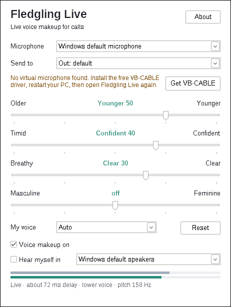

# Fledgling Live for Windows

Live voice makeup for Zoom, Teams, Discord, Meet and anything else that uses a microphone on a PC.
It uses the same four sliders and the same streaming effect as the live box (`box/dsp/fx.c`):
Older ↔ Younger, Timid ↔ Confident, Breathy ↔ Clear, Masculine ↔ Feminine.



```
 your mic ──► Fledgling Live ──► "CABLE Input" ══ VB-CABLE ══► "CABLE Output" ──► Zoom / Teams / Discord
              (voice makeup)        (virtual cable driver)       (pick this as the mic)
                   └──► your headphones (optional "Hear myself")
```

Windows doesn't let an ordinary app create a microphone, so for now the app sends its output into
a free virtual audio cable (VB-CABLE), and the call app listens to the other end of that cable.
This is how Voicemod, Krisp and NVIDIA Broadcast work too, except they ship their own driver.

## Try it on your PC (about 5 minutes)

1. **Install VB-CABLE (free).** Download "VBCABLE_Driver_Pack" from <https://vb-audio.com/Cable/>,
   unzip it, right-click `VBCABLE_Setup_x64.exe` → **Run as administrator** → **Install Driver**.
   Restart the PC.
2. **Get Fledgling Live.** Either the portable `FledglingLive.exe` (just unzip and run), or the
   installer `FledglingLive-Setup-x.y.z.exe` from the GitHub Actions run (Actions tab →
   "Windows live app" → latest run → Artifacts). The installer needs no admin rights.
   Windows SmartScreen will warn that the app is unrecognised, because it isn't code-signed yet:
   click **More info → Run anyway**.
3. **Open Fledgling Live.** Pick your real microphone under *Microphone*. *Send to* picks
   **CABLE Input** by itself.
4. **In your call app**, choose **CABLE Output (VB-Audio Virtual Cable)** as the microphone.
   Leave the speaker as your normal headphones.
   - Zoom: Settings → Audio → Microphone. Turn off "Automatically adjust microphone volume".
   - Teams: Settings → Devices → Microphone. Set noise suppression to Low.
   - Discord: User Settings → Voice & Video → Input Device. Turn off Krisp noise suppression.
   - Quick check without a call: Windows **Voice Recorder / Sound Recorder** with CABLE Output as
     the mic, or Windows Sound settings → Input → CABLE Output → "Test your microphone".
5. Tick **Hear myself** (with headphones on) to hear the result live. The two bars show the mic
   level (grey) and the output level (green).

Tips: "My voice → Auto" decides lower or higher voice from your pitch after a few seconds of
speech; set it by hand if it guesses wrong. Untick **Voice makeup on** to compare with your real
voice (the delay stays the same, so there is no jump). Sliders snap to *off* near the middle.
Settings are saved in `%APPDATA%\Fledgling Live\settings.ini`.

## Delay

| Stage | Delay |
|---|---|
| Mic block (WASAPI shared mode, 10 ms) | ~10 ms |
| Voice effect (PSOLA, two periods of a low voice) | 21 ms |
| Clock-drift buffer between the mic and the cable | ~17 ms, grows by 2 ms after a dropout |
| Output block into the cable | ~10 ms |
| **App total** | **~55–60 ms** (shown live in the window) |

The call app then adds its own buffering, as it does with any mic. For speech this is fine;
lip-sync on video is still well within what people notice (~100 ms). Lowering it later is
possible with WASAPI's low-latency mode (`IAudioClient3`) and, with our own driver, by removing
the cable hop.

## Build

The app is plain C: Win32 for the window, [miniaudio](https://github.com/mackron/miniaudio)
(public domain / MIT-0) for WASAPI audio, and `box/dsp/fx.c` for the effect. No runtime is needed;
the exe is ~350 KB.

- **GitHub Actions** builds `FledglingLive.exe`, a portable zip and the installer on every push
  that touches `windows/` (`.github/workflows/windows-live.yml`).
- **From Linux:** `sudo apt install gcc-mingw-w64-x86-64 && make -C windows`
- **On Windows:** install [MSYS2](https://www.msys2.org/), then in the UCRT64 shell
  `pacman -S make mingw-w64-ucrt-x86_64-gcc` and `make -C windows`.
- Installer: [Inno Setup 6](https://jrsoftware.org/isinfo.php) (free, commercial use allowed),
  `iscc windows/installer/FledglingLive.iss`. Per-user install, no admin prompt, supports
  `/VERYSILENT` (a Microsoft Store requirement for EXE installers).

| File | What it does |
|---|---|
| `src/app.c` | the window: device pickers, sliders, meters, settings, VB-CABLE detection |
| `src/audio.c` | mic → effect → two outputs (virtual mic, headphones), reconnects when a device is unplugged |
| `src/ring.h` | lock-free ring with clock-drift correction (resamples by at most ±0.5 %) |
| `installer/FledglingLive.iss` | Inno Setup script |

## Selling it in the Microsoft Store

What the Store allows (Microsoft Store Policies 7.20, checked 2026-11-13):

- **MSIX packages can't install drivers.** A virtual microphone is a driver, so a pure MSIX app
  can never create its own mic.
- **Win32 apps can be listed as an `.exe` or `.msi` installer** that you host and sign yourself.
  It must install silently (`/VERYSILENT` works).
- **Policy 10.2 generally does not allow a dependency on non-Microsoft drivers.** Microsoft may
  allow it case by case for WHCP-certified (Windows Hardware Compatibility Program) drivers, and
  the dependency must be declared in the certification notes. So "please also install VB-CABLE"
  may be rejected, and VB-CABLE is not ours to certify.
- Non-game apps may use their own payment system and keep 100 %, or Microsoft's at 15 %.

Recommended route, cheapest first:

1. **Now: sell directly** (own website with a checkout such as Lemon Squeezy, Paddle or Gumroad),
   with VB-CABLE as a separate free download. VB-Audio's licensing page allows shipping VB-CABLE
   with an app, including a commercial one, as long as the app says where it comes from and that
   it is donationware; confirm the current terms with VB-Audio before bundling it in the installer.
   This also tells us whether people pay before spending on a driver.
2. **Try the Store with the EXE installer**, declaring the VB-CABLE dependency in the
   certification notes. If Microsoft rejects it, the listing waits for step 3.
3. **Own virtual microphone driver** ("Fledgling Live Mic"), started from Microsoft's SysVAD
   virtual audio sample (Windows-driver-samples, MIT licence). The app installer would install it,
   which removes VB-CABLE, the extra setup steps and one hop of delay. It needs an EV
   code-signing certificate, a Partner Center hardware account, and WHCP testing (HLK) for the
   Store. This is the bigger cost and the right moment is once step 1 shows demand.

Accounts and signing Yong will need:

| What | Cost | When |
|---|---|---|
| Microsoft Partner Center developer account (individual) | free since 2025 (company: $99 once) | before a Store submission |
| Code signing for the exe and installer: **Azure Artifact Signing** (was "Trusted Signing"), open to individuals | about $10/month | before selling, so SmartScreen stops warning |
| EV code-signing certificate (only for our own driver) | about $250–400/year, usually needs a registered business | step 3 |

## Not done yet

- Not tested on a real Windows PC yet. It was built here with MinGW and run under Wine, where the
  window, device lists, pitch tracking, meters and output all worked; real-time timing and
  VB-CABLE could not be checked there.
- Prank voices and presets from the phone app are not in the live effect yet.
- No tray icon, auto-start or hotkey for "makeup on/off" yet.
- No licensing/trial check yet (needed before selling).
